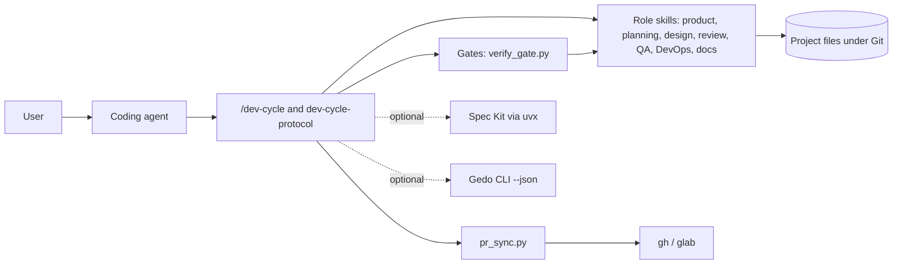

# ai-code-agent-skills — Technical Documentation

Entry point to the architecture of ai-code-agent-skills. This index is maintained with the
`architecture-docs` skill: the sections between `architecture-docs` markers are
generated by `build_index.py`; the rest is written by hand.

## System Overview

The repository is a modular monolith of skills: each skill is a folder with a `SKILL.md` that agents read and the Python scripts it runs. The user talks to an agent; `/dev-cycle` diagnoses the project and the cycle calls the role skills phase by phase. State lives in the project's files under Git (configuration, product docs, backlog, roadmap, plans, ADRs, manual tests); local search indexes and session memory live under `~/.ai-code-agent-memory/`. Pull requests are read and answered through the platform command lines.

## Subsystems

<!-- architecture-docs:subsystems:start -->
| Subsystem | Summary |
|---|---|
| [Cycle Orchestration](docs/architecture/cycle.md) | The /dev-cycle entry command, the phases and roles, the onboarding diagnosis and the gates. |
| [Design, Quality and Release](docs/architecture/quality-release.md) | The architecture style checks, test strategy and manual test runs, branching models, CI policy and releases. |
| [Documentation](docs/architecture/documentation.md) | Living technical docs with ADRs and end-user READMEs, each with a checker. |
| [Memory and Support Skills](docs/architecture/memory.md) | Each developer's session memory, folder RAG and the Gedo feedback log. |
| [Product and Planning](docs/architecture/planning.md) | Product inception, the backlog with epics, the roadmap of releases and the versioned plans with milestones. |
| [Project Configuration and Shared Kernel](docs/architecture/configuration.md) | The .dev-cycle.json configuration with its defaults and validation, and the attribution guard every posted text passes. |
| [Pull Request Sync](docs/architecture/pull-requests.md) | Reads and answers pull requests on GitHub and GitLab through one model, and holds the merge while something blocks it. |
| [Spec Kit Integration](docs/architecture/spec-kit.md) | Installs, pins, adopts and upgrades GitHub Spec Kit per project and generates its constitution from the baseline. |
<!-- architecture-docs:subsystems:end -->

## Architecture Decision Records

<!-- architecture-docs:adrs:start -->
| ADR | Title | Status | Version | Date |
|---|---|---|---|---|
| [ADR-0007](docs/adr/0007-native-rust-engine-translated-from-the-python-scripts.md) | Native Rust engine translated from the Python scripts | proposed |  | 2026-10-27 |
| [ADR-0006](docs/adr/0006-gedo-contract-discovered-by-capability-with-safe-fallback-pe.md) | Gedo contract discovered by capability with safe fallback per check | accepted | v3.1.0 | 2026-10-25 |
| [ADR-0005](docs/adr/0005-parallel-agents-only-with-gedo.md) | Parallel agents only with Gedo | accepted |  | 2026-10-25 |
| [ADR-0004](docs/adr/0004-gedo-integration-only-through-its-command-line.md) | Gedo integration only through its command line | accepted |  | 2026-10-25 |
| [ADR-0003](docs/adr/0003-pull-requests-through-the-platform-clis-on-the-rest-api.md) | Pull requests through the platform CLIs on the REST API | accepted | v2.8.1 | 2026-10-25 |
| [ADR-0002](docs/adr/0002-modular-monolith-of-skills-by-role.md) | Modular monolith of skills by role | accepted |  | 2026-10-25 |
| [ADR-0001](docs/adr/0001-skills-in-the-open-skill-md-format-with-python-scripts.md) | Skills in the open SKILL.md format with Python scripts | accepted |  | 2026-10-25 |
<!-- architecture-docs:adrs:end -->

## How to Update This Documentation

- **A subsystem changed** (behavior, structure, data): edit its page in `docs/architecture/` in place, replacing outdated text.
- **A decision with alternatives and trade-offs**: create an ADR with `new_adr.py` and link it from the subsystem page.
- **A decision that reverses or corrects another**: create a new ADR with `--supersedes` or `--amends`; never rewrite an accepted ADR.
- **A feature was removed**: remove it from the subsystem page; its ADRs stay as history.
- **A release**: nothing here; release notes live in the GitHub releases.
- Run `check_docs.py` before committing.
