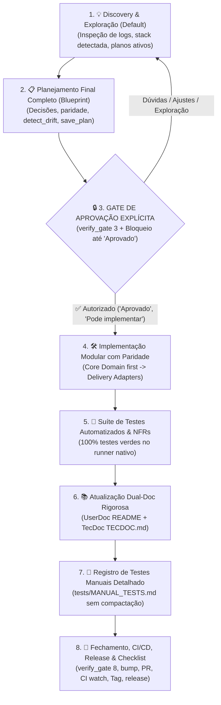

# 🛡️ Universal Development Cycle Protocol (`dev-cycle-protocol` v2.0)

> **Caminhos**: `<skills_root>` é a pasta que contém esta skill (o diretório pai da pasta deste `SKILL.md`). Use o caminho absoluto real ao executar os comandos.

O **`dev-cycle-protocol`** é o protocolo universal de governança, qualidade e ciclo de vida de desenvolvimento de software para projetos assistidos por IA em pair-programming.

Ele é **100% agnóstico a linguagens e projetos** (Rust, Python, TypeScript, Go, C++, Monorepos, etc.), garantindo que qualquer evolução técnica obedeça a padrões rigorosos de engenharia, isolamento de domínio, paridade entre interfaces, documentação técnica profunda, testes manuais não-truncados e persistência de decisões arquiteturais.

---

## 🏛️ Os Seis Pilares Invioláveis da Engenharia

Toda funcionalidade, refatoração ou correção em qualquer repositório deve obedecer rigorosamente a estes seis pilares fundamentais:

```
┌────────────────────────────────────────────────────────────────────────────────────────┐
│                        OS 7 PILARES INVIOLÁVEIS DA ENGENHARIA                          │
├────────────────────────────────────────────────────────────────────────────────────────┤
│ 1. 🧱 Modularização & Isolamento de Domínio (Single Responsibility & Clean Code)      │
│ 2. 🏛️ Arquitetura Hexagonal & Paridade Multi-Superfície (Ports & Adapters / Single DB) │
│ 3. 📚 Padrão Dual-Doc Rigoroso (UserDoc + TecDoc & ADRs)                               │
│ 4. 📝 Suíte de Testes Manuais Acumulativa e Não-Truncada (MANUAL_TESTS.md)             │
│ 5. 📐 Memória Persistente de Planos & Linhagem (plan-memory no ChromaDB)               │
│ 6. 🔒 Higiene de Segredos, Migrações Seguras & Protocolo de Rollback                   │
   7. **Acompanhamento Ininterrupto da Publicação da Release em Produção**: Acompanhar ativamente o workflow de release (`release.yml`) até o fim absoluto. A tarefa **SÓ PODE ser considerada concluída quando a aplicação estiver pronta, compilada e publicada no repositório designado de releases** (ex: `<org/releases-repo>`). Se o repositório de releases ainda não for conhecido, pergunte ao usuário. O assistente deve rodar `gh release view <tag> --repo <releases-repo>` e comprovar que todos os binários e assets estão disponíveis para download antes de emitir o relatório final.
└────────────────────────────────────────────────────────────────────────────────────────┘
```

### 1. 🧱 Modularização Rigorosa & Isolamento de Domínio
- **Responsabilidade Única (SRP)**: Cada módulo, classe ou função deve ter uma única razão para mudar.
- **Domínio Puro**: A lógica de negócio essencial deve ser desacoplada de frameworks de terceiros, drivers de banco, protocolos de rede e detalhes de interface.
- **Tipagem Estática e Tratamento Canônico de Erros**: Proibido silenciar exceções (`except: pass` ou `.unwrap()` cego em Rust). Todos os erros devem ser mapeados em tipos de erro canônicos e contextuais.

### 2. 🏛️ Arquitetura Hexagonal & Paridade Absoluta de Superfícies (*Ports & Adapters*)
- **O Core da Aplicação é o Centro do Universo**: Toda regra de negócio, serviços, comandos e cálculos residem exclusivamente no **Core** do projeto.
- **Superfícies de Apresentação são Apenas Adaptadores**: As interfaces pelas quais o software é consumido (**CLI Terminal, Desktop GUI, Web API REST, Stdio RPC, Protocolo MCP, Extensões**) são estritamente **Adaptadores de Entrada/Saída**. Nenhuma interface pode conter regras de negócio isoladas, filtros exclusivos ou bases de dados paralelas.
- **Instância Canônica de Estado / Banco de Dados (*Single Source of Truth*)**: Todas as interfaces em execução no ambiente devem operar sobre a **mesma base de dados/estado canônico**. É terminantemente proibida a criação de bancos secundários ou tabelas desconectadas para interfaces específicas.
- **Motor Central de Comandos (*Universal Command Engine*)**: Se o sistema oferece ações de usuário (ex: cadastrar, sincronizar, transferir, consultar), todas as interfaces ativas devem despachar para o mesmo serviço de domínio no Core.

#### Exemplos de Mapeamento por Ecossistema:
- **Rust**: Crate de domínio (`crates/<app>-core/`) contendo regras de negócio; binários adaptadores (`src/main.rs` para CLI, `crates/<app>-tauri` para desktop, bindings PyO3/Wasm).
- **Python**: Pacote de domínio (`src/<app>/core/` e `services/`); adaptadores de entrega (`cli.py`, `server/api.py`, `server/mcp.py`).
- **TypeScript/Node**: Pacote central (`packages/core/`); apps de apresentação (`apps/web/`, `apps/cli/`, `apps/desktop/`).
- **Go**: Domínio interno (`internal/domain/`); adaptadores (`cmd/cli/`, `cmd/server/`).

### 3. 📚 Padrão Dual-Doc de Documentação Rigorosa (*UserDoc + TecDoc*)
Toda funcionalidade implementada exige a atualização síncrona e detalhada de duas camadas documentais complementares:
- **`UserDoc` (Manual do Usuário & Experiência Operacional)**:
  - Focado no operador, usuário final ou desenvolvedor consumidor da API/CLI.
  - Abrange: `README.md`, menus de ajuda interativos (`--help`), tutoriais de início rápido, parâmetros de comandos e guias de resolução de problemas comuns.
- **`TecDoc` (Engenharia, Arquitetura & Deep-Dive Técnico)**:
  - Focado em mantenedores, arquitetos de software e auditores técnicos.
  - Abrange: `TECDOC.md` (ou `docs/architecture/`), diagramas de sequência e fluxo em **Mermaid**, fórmulas matemáticas, complexidade algorítmica, esquemas de banco de dados, rationale de decisões arquiteturais (ADRs) e matriz de tratamento de falhas.

### 4. 📝 Suíte de Testes Manuais Acumulativa & Não-Truncada (`MANUAL_TESTS.md`)
- **Regra de Não-Compactação**: **NUNCA compactar, resumir em uma linha ou truncar** os roteiros de testes manuais anteriores. O arquivo `tests/MANUAL_TESTS.md` (ou `MANUAL_TESTS.md`) deve acumular todos os cenários detalhados passo a passo (com comandos copiáveis, pré-requisitos, payloads e critérios de aceitação explícitos).
- **Quem esvazia é o Usuário**: O arquivo deve encher com os testes acumulados. O usuário é o único responsável por apagar os testes que ele já executou e validou.
- **Remoção pelo Assistente**: O assistente só deve remover ou retificar testes manuais antigos que ficaram **obsoletos/inválidos** devido a novas decisões arquiteturais (ex: endpoints removidos ou comandos descontinuados).

### 5. 📐 Memória Persistente de Planos & Linhagem (`plan-memory`)
- **Zero Compaction de Decisões Técnicas**: Todo planejamento arquitetural de múltiplas etapas, blueprint técnico e roadmap estratégico deve ser indexado integralmente no ChromaDB através da skill 👉 **[`plan-memory`](file:///<skills_root>/plan-memory/SKILL.md)**.
- **Linhagem e Rastreamento de Marcos**: Planos sucessores devem marcar planos antigos como `superseded` via `--supersedes`, mantendo o histórico navegável. Sub-etapas concluídas devem ser marcadas via `check_milestone.py`.
- **Prevenção Ativa de Desvios (*Plan Drift Detector*)**: Antes de implementar novas tarefas, valide se a proposta respeita os marcos e princípios do plano mestre via `detect_drift.py`.

### 6. 🔒 Higiene de Segredos, Migrações Seguras & Protocolo de Rollback
- **Higiene de Segredos**: Proibido commitar arquivos `.env`, chaves de API, certificados privados ou credenciais. O assistente deve verificar via `verify_gate.py` antes de qualquer commit.
- **Evolução de Banco de Dados sem Quebra (*Zero-Downtime Schema*)**: Alterações de esquema em SQLite, PostgreSQL ou similar devem ser aditivas ou compatíveis com versões anteriores, garantindo que interfaces legadas ou instâncias paralelas não entrem em crash.
- **Protocolo de Rollback Atômico**: Se um build falhar em produção ou uma regressão crítica for detectada no CI pós-merge, a ação imediata é disparar o revert do commit/PR na branch de produção e publicar uma tag de correção imediata (`vX.Y.Z+1`), em vez de tentar consertos desordenados direto em produção.

   7. **Acompanhamento Ininterrupto da Publicação da Release em Produção**: Acompanhar ativamente o workflow de release (`release.yml`) até o fim absoluto. A tarefa **SÓ PODE ser considerada concluída quando a aplicação estiver pronta, compilada e publicada no repositório designado de releases** (ex: `<org/releases-repo>`). Se o repositório de releases ainda não for conhecido, pergunte ao usuário. O assistente deve rodar `gh release view <tag> --repo <releases-repo>` e comprovar que todos os binários e assets estão disponíveis para download antes de emitir o relatório final.
- **O Trabalho Só Termina na Produção Verificada**: É expressamente proibido encerrar a tarefa ou devolver a palavra ao usuário apenas criando o Pull Request ou fazendo o push da tag. O assistente deve **acompanhar ativamente até o fim** cada job e step das GitHub Actions (`gh run watch` / `gh run list`).
- **Resolução Ativa de Falhas de CI**: Caso algum job do CI (testes automatizados, lint, build em matriz cross-platform) falhe, o assistente deve imediatamente inspecionar os logs do runner remoto (`gh run view --log-failed`), reproduzir localmente, aplicar a correção e atualizar o branch até que todos os checks fiquem 100% verdes.
- **Publicação Obrigatória no Repositório de Releases (Agnóstico com Fallback para Pergunta)**: **Todas as releases sem exceção DEVEM ser publicadas no repositório designado de releases** (ex: `<org/releases-repo>`). Nenhuma release pode ficar confinada apenas em branches ou tags locais. Se o assistente ainda não souber ou não encontrar configurado qual é o repositório de destino das releases (em `.dev-cycle.json`, workflows de CI ou documentação técnica), o assistente **DEVE obrigatoriamente perguntar ao usuário** antes de concluir. O assistente é obrigado a inspecionar remotamente (`gh release view <tag> --repo <org/releases-repo>`) e confirmar que todos os binários, checksums, scripts de instalação e assets estão publicados e disponíveis publicamente para download antes de considerar qualquer ciclo concluído.

---

## 🛡️ O Ciclo de Desenvolvimento de 8 Etapas com Gate de Aprovação



---

### 💡 Etapa 1: Discovery & Exploração (Modo Default)
- **Regra de Ouro**: O assistente permanece **100% em modo consultivo e analítico**.
- **Auto-Detecção do Perfil do Projeto**: O assistente inspeciona o ecossistema ativo via:
  ```powershell
  python "<skills_root>/dev-cycle-protocol/inspect_project.py"
  ```
- **Investigação Baseada em Logs em Primeiro Lugar (*Log-First Investigation*)**: Ao investigar qualquer erro, anomalia ou crash reportado pelo usuário, **a primeira ação obrigatória é inspecionar diretamente os arquivos de log** (`logs/`, logs de aplicação, instalação, compilação, stderr). Nunca formule hipóteses teóricas sem antes consultar as evidências reais dos logs.
- **Recuperação Prévia de Planos & Progresso de Marcos (`plan-memory`)**: Ao iniciar a discussão de novas funcionalidades ou refatorações, consulte o estado atual do projeto no banco vetorial:
  ```powershell
  python "<skills_root>/plan-memory/list_plans.py" --project "<projeto>"
  python "<skills_root>/plan-memory/check_milestone.py" --project "<projeto>" --list
  ```
- Enquanto o usuário estiver levantando hipóteses, fazendo perguntas (*"O que você acha?"*, *"E se fizermos X?"*) ou debatendo alternativas, **é terminantemente proibido propor comandos de edição, alterar arquivos ou iniciar código prematuramente**.
- O objetivo desta etapa é esgotar todas as dúvidas conceituais, validar viabilidade e convergir para a melhor arquitetura.

---

### 📋 Etapa 2: Planejamento Final Completo (Blueprint) & Indexação Persistente
- Quando as decisões estiverem amadurecidas, o assistente consolida e apresenta o **Planejamento Final Completo** utilizando o template estruturado padrão de 8 seções:
  1. 🎯 **Objetivo & Decisões Arquiteturais (ADR)**
  2. 🏛️ **Mapeamento de Paridade de Superfícies (Quais interfaces serão atualizadas)**
  3. 📁 **Arquivos e Linhas Impactadas**
  4. 📚 **Plano de Atualização Dual-Doc (`UserDoc` + `TecDoc`)**
  5. 🧪 **Estratégia de Testes Automatizados & Proteção contra Regressão**
  6. 📝 **Plano de Cenários de Teste Manual (`tests/MANUAL_TESTS.md`)**
  7. 🔒 **Higiene de Segredos, Migração de Banco e Plano de Rollback**
  8. ⏱️ **Passo a Passo da Execução**
- **Verificação Prévia de Desvio Arquitetural (`detect_drift.py`)**:
  Antes de apresentar o plano, valide se a proposta não viola princípios anteriores ou ordens de execução:
  ```powershell
  python "<skills_root>/plan-memory/detect_drift.py" --project "<projeto>" --proposal "<resumo_da_proposta>"
  ```
- **Indexação Obrigatória no ChromaDB (`plan-memory`)**:
  Todo planejamento com decisões arquiteturais ou plano de múltiplas etapas DEVE ser indexado integralmente no ChromaDB sem qualquer compactação através de:
  ```powershell
  python "<skills_root>/plan-memory/save_plan.py" `
    --project "<projeto>" `
    --title "<titulo_do_plano>" `
    --content "<conteudo_completo_markdown>" `
    --session-id "<session_id>" `
    --version "<versao_alvo>" `
    --tags "<tags>" `
    --milestones "<marcos_separados_por_virgula>" `
    [--supersedes "<old_plan_id>"]
  ```
- Finaliza com a pergunta padrão:
  > *"Este é o planejamento final completo. Deseja ajustar algum ponto ou autoriza o início da implementação?"*

---

### 🔒 Etapa 3: GATE DE APROVAÇÃO EXPLÍCITA (Imutável)
- **Verificação Automatizada do Gate 3**:
  ```powershell
  python "<skills_root>/dev-cycle-protocol/verify_gate.py" --gate 3 --project "<projeto>"
  ```
- A implementação **SÓ COMEÇA** após uma **autorização curta, direta e sem mais perguntas** do usuário (ex: *"Aprovado"*, *"Pode implementar"*, *"Autorizado"*, *"Go"*).
- Se a resposta do usuário contiver qualquer dúvida, ressalva ou nova ideia, o assistente **retorna automaticamente à Etapa 1** sem tocar em nenhum arquivo de código.

---

### 🛠️ Etapa 4: Implementação Modular com Paridade de Interfaces
- **Verificação de Árvore Git Limpa**: Certificar-se de que a branch está sincronizada com a remota antes de aplicar mudanças.
- **Ordem de Implementação**:
  1. **Core Domain**: Entidades, serviços, tipos canônicos e interfaces/traits.
  2. **Storage / State**: Migrações de esquema compatíveis e persistência.
  3. **Delivery Adapters**: CLI, Web API, RPC, MCP, UI Desktop, etc.
- **Tratamento de Exceções**: Todo erro propagado deve conter causa contextual clara.

---

### 🧪 Etapa 5: Suíte de Testes Automatizados & NFRs
- **Execução no Runner Nativo**:
  - Rust: `cargo test` (ou matriz MSVC/Linux)
  - Python: `pytest tests/` (usando o virtualenv correto)
  - Node/TypeScript: `npm test` / `pnpm test`
  - Go: `go test -v ./...`
- **Garantia de 100% de Testes Verdes**: Proibido avançar com qualquer teste falho ou quebrado.
- **Testes de Regressão**: Se a tarefa corrige um bug, um novo teste automatizado que reproduzia o bug deve ser adicionado para evitar regressão futura.

---

### 📚 Etapa 6: Atualização Dual-Doc Rigorosa & Detalhada
- **`UserDoc`**: Atualização do `README.md`, documentação de flags, telas de ajuda `/help` e exemplos práticos.
- **`TecDoc`**: Atualização do `TECDOC.md` (ou `docs/architecture/`):
  - Diagramas Mermaid de sequência e fluxo das novas interações.
  - Detalhamento de novos endpoints, estruturas de dados e regras de negócio.
  - Registro de Decisão Arquitetural (ADR) explicando o porquê da solução adotada.

---

### 📝 Etapa 7: Registro do Roteiro de Teste Manual Acumulativo (`tests/MANUAL_TESTS.md`)
- Gravação persistente e versionada do roteiro de testes passo a passo no arquivo `tests/MANUAL_TESTS.md`.
- **Sem compactação**: Adiciona o novo cenário detalhado no topo e preserva intactos todos os cenários anteriores não obsoletos com seus passos, comandos e critérios de aceitação.
- **Formato Mandatório do Cenário**:
  - **Identificador e Título**: `## Cenário X: [Nome da Funcionalidade]`
  - **Pré-requisitos e Ambiente**: Arquivos necessários, variáveis de ambiente e serviços ativos.
  - **Passo a Passo com Comandos Copiáveis**: Comandos exatos prontos para execução no terminal.
  - **Resultado Esperado (Critérios de Aceitação)**: Saída esperada no terminal, logs gerados e estado do banco de dados.

---

### 🚀 Etapa 8: Fechamento, CI/CD, Release em Produção & Checklist
- **Verificação Automatizada do Gate 8**:
  ```powershell
  python "<skills_root>/dev-cycle-protocol/verify_gate.py" --gate 8 --project "<projeto>"
  ```
- **Regra de Fechamento Integral (Da Concepção até a Release em Produção)**:
  1. **Version Bump Semântico Mandatório**: Para cada alteração, atualizar a versão de acordo com o tipo/nível da modificação (`pyproject.toml`, `Cargo.toml`, `package.json`, etc.):
     - **Major (X.0.0)**: Quebras drásticas de compatibilidade ou reformulação integral da arquitetura.
     - **Minor (0.X.0 / X.Y.0)**: Novas funcionalidades, migrações estruturais de schema de banco de dados ou normalização arquitetural.
     - **Patch (X.Y.Z)**: Correções de bugs, pequenas melhorias e ajustes retrocompatíveis.
  2. **Commit e Push no Branch de Desenvolvimento (`dev`)**: Commit semântico padronizado (`feat:`, `fix:`, `refactor:`).
  3. **Abertura do Pull Request (`dev` -> `main`)**: Criar o PR no GitHub via `gh pr create`.
  4. **Monitoramento Ininterrupto do CI & Auto-Correção no GitHub Actions**: Acompanhar minuciosamente todo o workflow do CI até a conclusão (`gh run list` / `gh run watch`). Qualquer erro ou falha identificada durante a execução dos jobs **DEVE ser imediatamente investigado, diagnosticado e corrigido no código**, realizando novo commit e reexecução. **NUNCA deixe um workflow quebrado ou falho sem corrigir**. O avanço para o merge só é válido com 100% de sucesso (verde) em todos os checks.
  5. **Merge para Produção (`main`)**: Realizar o merge do PR para a branch principal (`gh pr merge --merge`).
  6. **Criação e Push da Tag de Release (`vX.Y.Z`)**: Criar a tag Git anotada e fazer push para disparar o pipeline de release (`git tag -a vX.Y.Z -m "..." && git push origin vX.Y.Z`).
   7. **Acompanhamento Ininterrupto da Publicação da Release em Produção**: Acompanhar ativamente o workflow de release (`release.yml`) até o fim absoluto. A tarefa **SÓ PODE ser considerada concluída quando a aplicação estiver pronta, compilada e publicada no repositório designado de releases** (ex: `<org/releases-repo>`). Se o repositório de releases ainda não for conhecido, pergunte ao usuário. O assistente deve rodar `gh release view <tag> --repo <releases-repo>` e comprovar que todos os binários e assets estão disponíveis para download antes de emitir o relatório final.
  8. **Atualização do Ciclo de Vida do Plano & Conclusão de Marcos (`plan-memory`)**:
     ```powershell
     python "<skills_root>/plan-memory/check_milestone.py" --project "<projeto>" --milestone "<marco>" --notes "Entregue na release vX.Y.Z"
     ```
  9. **Registro Histórico na Memória de Sessão (`session-memory`)**: Gravação persistente do contexto da sessão.
  10. **Relatório Transparente**: Apresentar o checklist final detalhado comprovando que todas as 8 etapas foram concluídas até a publicação da release em produção.

---

## ⚙️ Manifesto Opcional de Customização (`.dev-cycle.json`)

Para projetos que possuem estruturas de pastas personalizadas, monorepos ou comandos específicos de teste, o desenvolvedor pode adicionar um arquivo `.dev-cycle.json` na raiz do repositório:

```json
{
  "project_name": "MeuProjeto",
  "core_path": "src/core",
  "doc_files": {
    "user_doc": "README.md",
    "tec_doc": "docs/ARCHITECTURE.md",
    "manual_tests": "tests/MANUAL_TESTS.md"
  },
  "test_commands": [
    "cargo test --all",
    "pytest tests/unit"
  ],
  "surfaces": [
    "cli",
    "desktop-tauri",
    "rest-api",
    "mcp"
  ],
  "canonical_datastore": "data/app.db",
  "releases_repo": "<org/repo-releases>"
}
```

Se o arquivo não existir, os utilitários `inspect_project.py` e `verify_gate.py` detectam automaticamente a stack padrão do repositório.