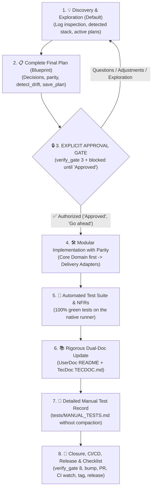

# 🛡️ Universal Development Cycle Protocol (`dev-cycle-protocol` v2.0)

> **Paths**: `<skills_root>` is the folder that contains this skill (the parent of this `SKILL.md`'s folder). Use the real absolute path when running the commands.

**`dev-cycle-protocol`** is the universal governance, quality and lifecycle protocol for AI-assisted pair-programming projects.

It is **100% language- and project-agnostic** (Rust, Python, TypeScript, Go, C++, monorepos, etc.), ensuring every technical change follows rigorous engineering standards: domain isolation, interface parity, deep technical documentation, non-truncated manual tests and persistent architectural decisions.

> **Language**: talk to the user in the language they use. Keep each project's existing documents (README, TECDOC, MANUAL_TESTS) in the language they are already written in.

---

## 🏛️ The Seven Inviolable Engineering Pillars

Every feature, refactor or fix in any repository must strictly follow these seven pillars:

```
┌────────────────────────────────────────────────────────────────────────────────────────┐
│                        THE 7 INVIOLABLE ENGINEERING PILLARS                            │
├────────────────────────────────────────────────────────────────────────────────────────┤
│ 1. 🧱 Modularization & Domain Isolation (Single Responsibility & Clean Code)            │
│ 2. 🏛️ Hexagonal Architecture & Multi-Surface Parity (Ports & Adapters / Single DB)      │
│ 3. 📚 Rigorous Dual-Doc Standard (UserDoc + TecDoc & ADRs)                             │
│ 4. 📝 Cumulative, Non-Truncated Manual Test Suite (MANUAL_TESTS.md)                    │
│ 5. 📐 Persistent Plan Memory & Lineage (plan-memory in ChromaDB)                       │
│ 6. 🔒 Secret Hygiene, Safe Migrations & Rollback Protocol                              │
│ 7. 🚀 Uninterrupted Follow-Through until the Release Is Verified in Production         │
└────────────────────────────────────────────────────────────────────────────────────────┘
```

### 1. 🧱 Rigorous Modularization & Domain Isolation
- **Single Responsibility (SRP)**: Each module, class or function must have a single reason to change.
- **Pure Domain**: Core business logic must be decoupled from third-party frameworks, database drivers, network protocols and interface details.
- **Static Typing and Canonical Error Handling**: Silencing exceptions is forbidden (`except: pass` or blind `.unwrap()` in Rust). All errors must be mapped to canonical, contextual error types.

### 2. 🏛️ Hexagonal Architecture & Absolute Surface Parity (*Ports & Adapters*)
- **The Application Core Is the Center of the Universe**: All business rules, services, commands and calculations live exclusively in the project's **Core**.
- **Presentation Surfaces Are Only Adapters**: The interfaces through which the software is consumed (**terminal CLI, desktop GUI, REST web API, stdio RPC, MCP protocol, extensions**) are strictly **input/output adapters**. No interface may hold isolated business rules, exclusive filters or parallel databases.
- **Canonical State / Database Instance (*Single Source of Truth*)**: Every interface running in the environment must operate on the **same canonical database/state**. Creating secondary databases or disconnected tables for specific interfaces is strictly forbidden.
- **Universal Command Engine**: If the system offers user actions (e.g. register, sync, transfer, query), every active interface must dispatch to the same domain service in the Core.

#### Mapping Examples by Ecosystem:
- **Rust**: Domain crate (`crates/<app>-core/`) holding business rules; adapter binaries (`src/main.rs` for CLI, `crates/<app>-tauri` for desktop, PyO3/Wasm bindings).
- **Python**: Domain package (`src/<app>/core/` and `services/`); delivery adapters (`cli.py`, `server/api.py`, `server/mcp.py`).
- **TypeScript/Node**: Core package (`packages/core/`); presentation apps (`apps/web/`, `apps/cli/`, `apps/desktop/`).
- **Go**: Internal domain (`internal/domain/`); adapters (`cmd/cli/`, `cmd/server/`).

### 3. 📚 Rigorous Dual-Doc Documentation Standard (*UserDoc + TecDoc*)
Every implemented feature requires a synchronized, detailed update of two complementary documentation layers:
- **`UserDoc` (User Manual & Operational Experience)**:
  - Aimed at the operator, end user or developer consuming the API/CLI.
  - Covers: `README.md`, interactive help menus (`--help`), quick-start tutorials, command parameters and troubleshooting guides.
- **`TecDoc` (Engineering, Architecture & Technical Deep-Dive)**:
  - Aimed at maintainers, software architects and technical auditors.
  - Covers: `TECDOC.md` (or `docs/architecture/`), **Mermaid** sequence and flow diagrams, mathematical formulas, algorithmic complexity, database schemas, architecture decision records (ADRs) and the failure-handling matrix.

### 4. 📝 Cumulative, Non-Truncated Manual Test Suite (`MANUAL_TESTS.md`)
- **No-Compaction Rule**: **NEVER compact, summarize into one line or truncate** previous manual test scripts. The `tests/MANUAL_TESTS.md` (or `MANUAL_TESTS.md`) file must accumulate every detailed step-by-step scenario (with copyable commands, prerequisites, payloads and explicit acceptance criteria).
- **The User Empties It**: The file fills up with accumulated tests. The user alone is responsible for deleting the tests they have already run and validated.
- **Removal by the Assistant**: The assistant may only remove or fix old manual tests that became **obsolete/invalid** due to new architectural decisions (e.g. removed endpoints or discontinued commands).

### 5. 📐 Persistent Plan Memory & Lineage (`plan-memory`)
- **Zero Compaction of Technical Decisions**: Every multi-step architectural plan, technical blueprint and strategic roadmap must be indexed in full in ChromaDB through the 👉 **[`plan-memory`](../plan-memory/SKILL.md)** skill.
- **Lineage and Milestone Tracking**: Successor plans must mark old plans as `superseded` via `--supersedes`, keeping history navigable. Completed sub-steps must be checked off via `check_milestone.py`.
- **Active Drift Prevention (*Plan Drift Detector*)**: Before implementing new tasks, validate that the proposal respects the master plan's milestones and principles via `detect_drift.py`.

### 6. 🔒 Secret Hygiene, Safe Migrations & Rollback Protocol
- **Secret Hygiene**: Committing `.env` files, API keys, private certificates or credentials is forbidden. The assistant must check via `verify_gate.py` before any commit.
- **Non-Breaking Database Evolution (*Zero-Downtime Schema*)**: Schema changes in SQLite, PostgreSQL or similar must be additive or backward compatible, so legacy interfaces or parallel instances do not crash.
- **Atomic Rollback Protocol**: If a build fails in production or a critical regression is detected in post-merge CI, the immediate action is to revert the commit/PR on the production branch and publish an immediate fix tag (`vX.Y.Z+1`), instead of attempting disorderly fixes directly in production.

### 7. 🚀 Uninterrupted Follow-Through until the Release Is Verified in Production
- **Work Only Ends in Verified Production**: It is expressly forbidden to end the task or hand control back to the user after merely creating the pull request or pushing the tag. The assistant must **actively follow every GitHub Actions job and step to the end** (`gh run watch` / `gh run list`).
- **Active CI Failure Resolution**: If any CI job fails (automated tests, lint, cross-platform matrix build), the assistant must immediately inspect the remote runner logs (`gh run view --log-failed`), reproduce locally, apply the fix and update the branch until all checks are 100% green.
- **Mandatory Publication to the Releases Repository (Agnostic, with Fallback to Asking)**: **Every release without exception MUST be published to the designated releases repository** (e.g. `<org/releases-repo>`). No release may stay confined to local branches or tags. If the assistant does not yet know, or cannot find configured, the target releases repository (in `.dev-cycle.json`, CI workflows or technical documentation), the assistant **MUST ask the user** before finishing. The assistant must inspect remotely (`gh release view <tag> --repo <org/releases-repo>`) and confirm that all binaries, checksums, install scripts and assets are published and publicly downloadable before considering any cycle complete.

---

## 🛡️ The 8-Step Development Cycle with Approval Gate



---

### 💡 Step 1: Discovery & Exploration (Default Mode)
- **Golden Rule**: The assistant stays **100% in consultative and analytical mode**.
- **Project Profile Auto-Detection**: The assistant inspects the active ecosystem via:
  ```powershell
  python "<skills_root>/dev-cycle-protocol/inspect_project.py"
  ```
- **Log-First Investigation**: When investigating any error, anomaly or crash reported by the user, **the first mandatory action is to inspect the log files directly** (`logs/`, application, install and build logs, stderr). Never form theoretical hypotheses before checking the real evidence in the logs.
- **Prior Retrieval of Plans & Milestone Progress (`plan-memory`)**: When starting a discussion about new features or refactors, check the project's current state in the vector database:
  ```powershell
  python "<skills_root>/plan-memory/list_plans.py" --project "<project>"
  python "<skills_root>/plan-memory/check_milestone.py" --project "<project>" --list
  ```
- While the user is raising hypotheses, asking questions (*"What do you think?"*, *"What if we do X?"*) or debating alternatives, **proposing edit commands, changing files or starting code prematurely is strictly forbidden**.
- The goal of this step is to exhaust all conceptual questions, validate feasibility and converge on the best architecture.

---

### 📋 Step 2: Complete Final Plan (Blueprint) & Persistent Indexing
- Once decisions have matured, the assistant consolidates and presents the **Complete Final Plan** using the standard 8-section template:
  1. 🎯 **Goal & Architecture Decisions (ADR)**
  2. 🏛️ **Surface Parity Mapping (which interfaces will be updated)**
  3. 📁 **Affected Files and Lines**
  4. 📚 **Dual-Doc Update Plan (`UserDoc` + `TecDoc`)**
  5. 🧪 **Automated Testing Strategy & Regression Protection**
  6. 📝 **Manual Test Scenario Plan (`tests/MANUAL_TESTS.md`)**
  7. 🔒 **Secret Hygiene, Database Migration and Rollback Plan**
  8. ⏱️ **Step-by-Step Execution**
- **Prior Architectural Drift Check (`detect_drift.py`)**:
  Before presenting the plan, validate that the proposal does not violate earlier principles or execution order:
  ```powershell
  python "<skills_root>/plan-memory/detect_drift.py" --project "<project>" --proposal "<proposal_summary>"
  ```
- **Mandatory Indexing in ChromaDB (`plan-memory`)**:
  Every plan with architecture decisions or multiple steps MUST be indexed in full in ChromaDB, without any compaction, via:
  ```powershell
  python "<skills_root>/plan-memory/save_plan.py" `
    --project "<project>" `
    --title "<plan_title>" `
    --content "<full_markdown_content>" `
    --session-id "<session_id>" `
    --version "<target_version>" `
    --tags "<tags>" `
    --milestones "<comma_separated_milestones>" `
    [--supersedes "<old_plan_id>"]
  ```
- End with the standard question (in the user's language):
  > *"This is the complete final plan. Would you like to adjust anything, or do you authorize the start of implementation?"*

---

### 🔒 Step 3: EXPLICIT APPROVAL GATE (Immutable)
- **Automated Gate 3 Check**:
  ```powershell
  python "<skills_root>/dev-cycle-protocol/verify_gate.py" --gate 3 --project "<project>"
  ```
- Implementation **ONLY STARTS** after a **short, direct authorization with no further questions** from the user (e.g. *"Aprovado"*, *"Pode implementar"*, *"Autorizado"*, *"Approved"*, *"Go"*).
- If the user's reply contains any question, reservation or new idea, the assistant **automatically returns to Step 1** without touching any code file.

---

### 🛠️ Step 4: Modular Implementation with Interface Parity
- **Clean Git Tree Check**: Make sure the branch is in sync with the remote before applying changes.
- **Implementation Order**:
  1. **Core Domain**: Entities, services, canonical types and interfaces/traits.
  2. **Storage / State**: Compatible schema migrations and persistence.
  3. **Delivery Adapters**: CLI, web API, RPC, MCP, desktop UI, etc.
- **Exception Handling**: Every propagated error must carry a clear contextual cause.

---

### 🧪 Step 5: Automated Test Suite & NFRs
- **Run on the Native Runner**:
  - Rust: `cargo test` (or MSVC/Linux matrix)
  - Python: `pytest tests/` (using the correct virtualenv)
  - Node/TypeScript: `npm test` / `pnpm test`
  - Go: `go test -v ./...`
- **100% Green Tests Guaranteed**: Moving forward with any failing or broken test is forbidden.
- **Regression Tests**: If the task fixes a bug, a new automated test that reproduced the bug must be added to prevent future regressions.

---

### 📚 Step 6: Rigorous, Detailed Dual-Doc Update
- **`UserDoc`**: Update `README.md`, flag documentation, `/help` screens and practical examples.
- **`TecDoc`**: Update `TECDOC.md` (or `docs/architecture/`):
  - Mermaid sequence and flow diagrams of the new interactions.
  - Details of new endpoints, data structures and business rules.
  - Architecture Decision Record (ADR) explaining why the adopted solution was chosen.

---

### 📝 Step 7: Cumulative Manual Test Script Record (`tests/MANUAL_TESTS.md`)
- Persist and version the step-by-step test script in `tests/MANUAL_TESTS.md`.
- **No compaction**: Add the new detailed scenario at the top and keep every earlier non-obsolete scenario intact, with its steps, commands and acceptance criteria.
- **Mandatory Scenario Format** (in the language the file already uses):
  - **Identifier and Title**: `## Scenario X: [Feature Name]` (or `## Cenário X: ...` in a Portuguese file)
  - **Prerequisites and Environment**: Required files, environment variables and running services.
  - **Step by Step with Copyable Commands**: Exact commands ready to run in the terminal.
  - **Expected Result (Acceptance Criteria)**: Expected terminal output, generated logs and database state.

---

### 🚀 Step 8: Closure, CI/CD, Production Release & Checklist
- **Automated Gate 8 Check**:
  ```powershell
  python "<skills_root>/dev-cycle-protocol/verify_gate.py" --gate 8 --project "<project>"
  ```
- **Full Closure Rule (From Conception to Production Release)**:
  1. **Mandatory Semantic Version Bump**: For every change, update the version according to the type/level of the change (`pyproject.toml`, `Cargo.toml`, `package.json`, etc.):
     - **Major (X.0.0)**: Drastic compatibility breaks or a complete architecture overhaul.
     - **Minor (0.X.0 / X.Y.0)**: New features, structural database schema migrations or architectural normalization.
     - **Patch (X.Y.Z)**: Bug fixes, small improvements and backward-compatible adjustments.
  2. **Commit and Push to the Development Branch (`dev`)**: Standard semantic commit (`feat:`, `fix:`, `refactor:`).
  3. **Open the Pull Request (`dev` -> `main`)**: Create the PR on GitHub via `gh pr create`.
  4. **Uninterrupted CI Monitoring & Self-Correction on GitHub Actions**: Follow the entire CI workflow closely until completion (`gh run list` / `gh run watch`). Any error or failure found while the jobs run **MUST be immediately investigated, diagnosed and fixed in the code**, with a new commit and re-run. **NEVER leave a broken or failed workflow unfixed**. Moving on to merge is only valid with 100% success (green) on all checks.
  5. **Merge to Production (`main`)**: Merge the PR into the main branch (`gh pr merge --merge`).
  6. **Create and Push the Release Tag (`vX.Y.Z`)**: Create the annotated Git tag and push it to trigger the release pipeline (`git tag -a vX.Y.Z -m "..." && git push origin vX.Y.Z`).
  7. **Uninterrupted Follow-Up of the Production Release**: Actively follow the release workflow (`release.yml`) to the very end. The task **can ONLY be considered complete when the application is ready, built and published to the designated releases repository** (e.g. `<org/releases-repo>`). If the releases repository is not yet known, ask the user. The assistant must run `gh release view <tag> --repo <releases-repo>` and prove that all binaries and assets are available for download before issuing the final report.
  8. **Plan Lifecycle Update & Milestone Completion (`plan-memory`)**:
     ```powershell
     python "<skills_root>/plan-memory/check_milestone.py" --project "<project>" --milestone "<milestone>" --notes "Delivered in release vX.Y.Z"
     ```
  9. **Historical Record in Session Memory (`session-memory`)**: Persist the session context.
  10. **Transparent Report**: Present the detailed final checklist proving that all 8 steps were completed through the production release.

---

## ⚙️ Optional Customization Manifest (`.dev-cycle.json`)

For projects with custom folder structures, monorepos or specific test commands, the developer can add a `.dev-cycle.json` file at the repository root:

```json
{
  "project_name": "MyProject",
  "core_path": "src/core",
  "doc_files": {
    "user_doc": "README.md",
    "tec_doc": "docs/ARCHITECTURE.md",
    "manual_tests": "tests/MANUAL_TESTS.md"
  },
  "test_commands": [
    "cargo test --all",
    "pytest tests/unit"
  ],
  "surfaces": [
    "cli",
    "desktop-tauri",
    "rest-api",
    "mcp"
  ],
  "canonical_datastore": "data/app.db",
  "releases_repo": "<org/repo-releases>"
}
```

If the file does not exist, `inspect_project.py` and `verify_gate.py` automatically detect the repository's standard stack.
