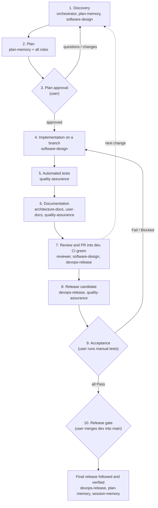

# 🛡️ Development Cycle Protocol (`dev-cycle-protocol` v3)

> **Paths**: `<skills_root>` is the folder that contains this skill (the parent of this `SKILL.md`'s folder). Use the real absolute path when running the commands.

**`dev-cycle-protocol`** orchestrates software work like a team of specialists. It owns the **phases, the gates and which role runs when**; each role skill owns its own artifact, rules and checker. It is language- and project-agnostic.

> **Language**: talk to the user in the language they use, but write every project artifact in **English**: code, comments, documentation, ADRs, plans, manual tests, commit messages and pull request descriptions. A project can set another documentation language in `.dev-cycle.json` (`architecture_docs.language`).

---

## 👥 Roles

| Role | Skill | Owns |
|---|---|---|
| Orchestrator | `dev-cycle-protocol` | Phases, gates, the path for each change, `.dev-cycle.json` |
| Planner | [`plan-memory`](../plan-memory/SKILL.md) | The backlog (`docs/BACKLOG.md`, `/backlog` command), plan files in `docs/plans`, milestones, drift detection |
| Architect | [`software-design`](../software-design/SKILL.md) | Design principles, architecture style, design section of plans, structural review |
| Technical documentation | [`architecture-docs`](../architecture-docs/SKILL.md) | `TECDOC.md`, `docs/architecture`, ADRs |
| QA | [`quality-assurance`](../quality-assurance/SKILL.md) | Automated test strategy, curated manual test suite, release candidate runs |
| DevOps | [`devops-release`](../devops-release/SKILL.md) | Branches, CI, versions, release candidates, releases, observability |
| Technical writer | [`user-docs`](../user-docs/SKILL.md) | README and end-user documentation |
| Reviewer | code review (the agent's review capability or a second session) | Independent review of the diff before the pull request |
| Session memory | [`session-memory`](../session-memory/SKILL.md) | The developer's own session context |

A role is a set of rules and a checker, not a separate person: load the role skill when its phase starts, follow it, and run its checker before leaving the phase.

---

## 🏛️ Principles

1. **Design**: modular code with clear responsibilities, SOLID, Clean Code, explicit errors, patterns only when needed, in the project's architecture style (`software-design`).
2. **Evidence**: every change is proven by automated tests; manual tests cover only what cannot be automated, in one curated suite (`quality-assurance`).
3. **Documentation describes today**: technical docs and README are edited in place; history lives in Git and release notes (`architecture-docs`, `user-docs`).
4. **Plans are shared and complete**: approved plans are versioned files in the project (`plan-memory`).
5. **Safe delivery**: short-lived branches, CI on every pull request, release candidates, the user's merge as the release gate (`devops-release`).
6. **Security**: no secrets in Git, backward-compatible data migrations, a rollback path for every release.
7. **Bugs first**: open `critical` and `high` bugs are planned and fixed before new features, improvements and adjustments, unless the user explicitly accepts the risk; nothing found is lost, it is fixed now or captured in the backlog.
8. **Follow-through**: the agent follows CI and releases to the end and fixes what fails; the user's decisions (plan approval, candidate acceptance, merge into production) are never taken by the agent.

---

## 🧭 Choosing the Path

| Path | When | Phases |
|---|---|---|
| **Full** | New features, refactors, data or schema changes, changes to commands, configuration, file formats or public APIs, CI/release changes, anything spanning several modules | 1 to 7 per change; 8 to 10 per release |
| **Short** | Small bug fixes, documentation-only, test-only or typo changes that fit in one small pull request and change no interface or data | 1, 4, 5, 6 (only what is affected), 7 |

For the short path, the user's request is the approval when it names the change ("fix the crash in X"); otherwise describe the change in one or two sentences and wait for the user's go. When in doubt, use the full path.

---

## 🔄 The Cycle



Phases 1 to 7 run for every change. Phases 8 to 10 run when the user wants to release what has accumulated in the integration branch.

### 1. 💡 Discovery
- Stay **consultative**: while the user is asking, debating or proposing, do not edit files or start code.
- Inspect the project and its configuration:
  ```powershell
  python "<skills_root>/dev-cycle-protocol/inspect_project.py"
  python "<skills_root>/dev-cycle-protocol/project_config.py" --validate
  ```
- **Logs first**: for any reported error, read the real logs before forming hypotheses.
- Read the active plans (`plan-memory/list_plans.py`, `check_milestone.py --list`) and the architecture style and structure (`software-design`).
- Read the backlog (`plan-memory/backlog.py summary`; `inspect_project.py` shows it too). Show the user the open bugs that come before new work and the items related to the request; the user decides what to promote, re-prioritize or drop (see "Backlog").
- To plan backlog items, promote them (`backlog.py promote <ID> ...`): the draft plan (a bug plan for bugs) is where the discovery is written.
- Exhaust the open questions and converge on an approach with the user.

### 2. 📋 Plan
Write the complete plan with this template, collecting each role's section:

1. **Goal and decisions**: what changes and why; decisions with alternatives become ADRs (`architecture-docs`).
2. **Design** (`software-design`): where each piece lives, interfaces, data flow, error strategy, dependencies, what is deliberately not abstracted.
3. **Affected surfaces and files**: interfaces in `architecture.surfaces` that change; files and modules.
4. **Tests** (`quality-assurance`): automated tests to add (a regression test per bug), manual tests to add, change or remove, acceptance criteria.
5. **Documentation** (`architecture-docs`, `user-docs`): subsystem pages and ADRs, README sections.
6. **CI, release and observability** (`devops-release`): workflow changes, version impact, logs, diagnostics and telemetry to add and how they are tested.
7. **Security, migration and rollback**: secrets, data migrations (backward compatible), how to roll back.
8. **Execution steps and milestones**.

Check for drift and save the plan in full:
```powershell
python "<skills_root>/plan-memory/detect_drift.py" --proposal "<proposal summary>"
python "<skills_root>/plan-memory/save_plan.py" --title "<title>" --file "<plan.md>" --version "<target version>" --milestones "<m1,m2,...>" [--supersedes "<old_plan_id>"]
```
End with (in the user's language): *"This is the complete plan. Would you like to adjust anything, or do you approve the start of implementation?"*

### 3. 🔒 Plan Approval Gate (user)
```powershell
python "<skills_root>/dev-cycle-protocol/verify_gate.py" --gate 3
```
- Implementation starts **only** after a short, explicit approval from the user ("Approved", "Go ahead"). A reply with a question, a reservation or a new idea goes back to Phase 1.
- After approval, commit the plan file (`docs(plan): <title>`) on the work branch.

### 4. 🛠️ Implementation
- Create the branch from the integration branch (`devops-release` naming: `feat/`, `fix/`, `docs/`, ...).
- Follow `software-design`: core and domain first, then storage, then the adapters of each affected surface; one responsibility per unit; explicit errors.
- Mark plan milestones as they are completed (`plan-memory/check_milestone.py`).

### 5. 🧪 Automated Tests
- Run `test_commands` (or the stack's runner) and follow `quality-assurance`. Every bug fix has a regression test. **Never move on with a failing test.**

### 6. 📚 Documentation
- Technical docs: edit the affected `docs/architecture` pages in place, add ADRs for decisions, run `build_index.py` and `check_docs.py` (zero errors).
- README: edit the affected sections with `user-docs` and run `check_readme.py` (zero errors).
- Manual tests: curate the suite for the features touched (`quality-assurance`) and run `manual_tests.py validate`.

### 7. 🔍 Review and Pull Request
- Review the diff (code review), run the `software-design` checklist and `check_design.py`.
- Commit with Conventional Commits, push, and open the pull request **into the integration branch**.
- Follow CI to the end; read the logs of any failure, reproduce, fix and push until every check is green (`devops-release`). The user merges the pull request (or authorizes the agent to merge into the integration branch).

### 8. 🧪 Release Candidate (per release)
- `devops-release`: bump the version in `devops.version_files` (on a branch, through a pull request), then tag `vX.Y.Z-rc.N` from the integration branch, follow the pipeline and verify the pre-release (`release_status.py verify`).
- `quality-assurance`: start the candidate's manual test run (`manual_tests.py start-run --run vX.Y.Z-rc.N ...`) and commit it.
- Tell the user how to install the candidate and which tests to run.

### 9. ✅ Acceptance Gate (user)
- The user installs the candidate and marks each test Pass, Fail or Blocked.
- Read the results (`manual_tests.py failed --run <rc>`): each failure goes back to Phase 4 as a fix, followed by a new candidate and run. A failure the user decides to leave for later is captured in the backlog (`backlog.py add --from-failed --run <rc>`).
- The candidate is accepted when the acceptance gate passes:
  ```powershell
  python "<skills_root>/dev-cycle-protocol/verify_gate.py" --gate rc --run vX.Y.Z-rc.N
  ```

### 10. 🚀 Release Gate (user) and Verified Release
- Run the release readiness gate, then open the pull request from the integration branch into the production branch with the release notes highlights (user-visible changes, upgrade steps, known limitations):
  ```powershell
  python "<skills_root>/dev-cycle-protocol/verify_gate.py" --gate 8 --run vX.Y.Z-rc.N
  ```
- **The user merges.** The agent never merges into the production branch, never pushes a final tag by hand and never publishes a final release.
- The merge creates the final tag and release (`devops-release` tag-on-merge). Follow the workflow to the end and verify the published release (`release_status.py verify --tag vX.Y.Z`). If the releases repository is unknown, ask the user.
- Close the plan milestones and update the plan status (`plan-memory`), and record the session (`session-memory`).
- Report: what was released, the verified release link, and anything left open.

---

## 📥 Backlog

The backlog (`backlog.file` in `.dev-cycle.json`, default `docs/BACKLOG.md`) is the first level of planning: bugs, features, improvements and adjustments captured for later, without discovery. The second level is the plan, created when the user promotes items.

- **Capture**: the user types `/backlog --feature|--improvement|--adjustment|--bug "<text>"` (the [`backlog`](../backlog/SKILL.md) command) or asks to note something for later; the agent runs `plan-memory/backlog.py add` and answers with the new id.
- **Bugs found during work**: in scope and small, fix them now with a regression test. Otherwise capture them (`backlog.py add --type bug --severity <s> ...`) and report the ids in the phase report and in the pull request description, which links backlog ids instead of carrying loose "to decide" lists.
- **Triage is the user's**: the agent never promotes, drops or re-prioritizes on its own; it shows the summary at discovery and asks.
- **Bugs first**: gate 3 blocks a plan that is not a bug plan while an open bug with a blocking severity (`backlog.blocking_severities`, default `critical` and `high`) is outside it. Only when the user explicitly accepts the risk, run the gate with `--accept-open-bugs "<the user's reason>"`; the reason is recorded in the plan.
- **Closing**: items close as done when their plan is completed, or with `backlog.py close <ID> --ref "PR #N"`; `drop` and `duplicate` record why.
- **Release**: gate 8 validates the backlog and lists open blocking bugs, which go into the release notes as known limitations.

---

## 🔐 Security, Data and Rollback

- **Secrets**: never commit `.env` files, keys, certificates or credentials; `verify_gate.py` checks tracked and staged files.
- **Data migrations** are additive or backward compatible so older versions and parallel instances keep working; destructive changes need a plan section and a backup step.
- **Rollback**: a broken release is reverted through a pull request on the production branch and followed by the next patch release (`devops-release`).

---

## ⚙️ Gates and Commands

| Gate | When | Checks |
|---|---|---|
| `--gate 3 [--accept-open-bugs R]` | Before asking for plan approval | Working tree state, active plan saved (and committed after approval), bugs first (no open blocking bug outside a non-bug plan, unless the user accepts with reason `R`), secret hygiene |
| `--gate rc --run R` | Before declaring a candidate accepted | Every manual test of run `R` is Pass (`quality-assurance/manual_tests.py gate`) |
| `--gate 8 [--run R]` | Before opening the release pull request | Documentation and manual test files exist; `check_docs.py`, `check_readme.py`, `manual_tests.py validate`, `check_design.py`, `check_ci_policy.py` and `backlog.py validate` have no errors (open blocking bugs are listed for the release notes); version files agree; the candidate run passed (required with `--run` when release candidates are on); secret hygiene; clean working tree |

```powershell
python "<skills_root>/dev-cycle-protocol/verify_gate.py" --gate 3|rc|8 [--run <rc tag>] [--accept-open-bugs "<reason>"] [--dir <project>]
python "<skills_root>/dev-cycle-protocol/inspect_project.py" [--json]
python "<skills_root>/dev-cycle-protocol/project_config.py" [--json] [--validate] [--migrate [--write]]
```

---

## ⚙️ Project Configuration (`.dev-cycle.json`)

Optional file at the repository root: the project configuration shared by every skill, with one section per skill (`architecture`, `docs`, `tests`, `devops`, `plans`, `backlog`, `architecture_docs`, `drift_rules`) and `test_commands`. Read it through the single loader, which fills defaults, accepts the legacy flat keys of older files and validates the result (`project_config.py`). Scripts of other skills import it from the sibling folder (`from project_config import load_project_config`). The full key reference is in the skills repository README ("Project configuration").

If the file does not exist, `inspect_project.py` and `verify_gate.py` detect the repository's standard stack and use the defaults.
