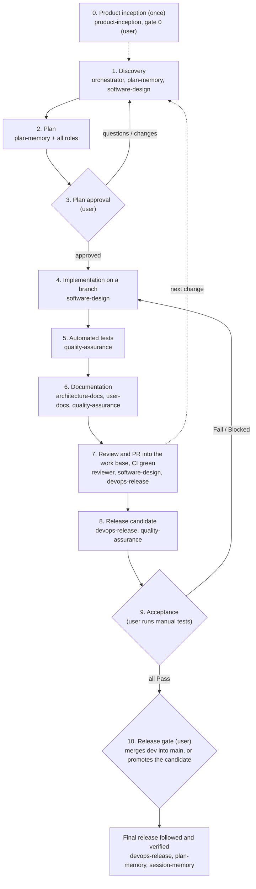

# 🛡️ Development Cycle Protocol (`dev-cycle-protocol` v4)

> **Paths**: `<skills_root>` is the folder that contains this skill (the parent of this `SKILL.md`'s folder). Use the real absolute path when running the commands. Run them from the project's repository (or pass `--dir`): a session that starts above it, such as a cloud session in `/home/user`, would otherwise read the wrong folder.
>
> **Engine**: scripts already translated to Rust (IMP-005) run through the launcher, written here `"<skills_root>/dev-cycle-protocol/bin/dev-cycle" <skill> <script> [args]` (sh shells: Linux, macOS, Git Bash). In PowerShell, run `& "<skills_root>/dev-cycle-protocol/bin/dev-cycle.ps1" <skill> <script> [args]`. The first run downloads the engine for the machine and checks its checksum.

**`dev-cycle-protocol`** orchestrates software work like a team of specialists. It owns the **phases, the gates and which role runs when**; each role skill owns its own artifact, rules and checker. It is language- and project-agnostic.

> **Language**: talk to the user in the language they use, but write every project artifact in **English**: code, comments, documentation, ADRs, plans, manual tests, commit messages and pull request descriptions. A project can set another documentation language in `.dev-cycle.json` (`architecture_docs.language`).

---

## 🧭 Starting a Session (`/dev-cycle`)

The user starts with one command, [`/dev-cycle`](../dev-cycle/SKILL.md) (with a product idea or a request, or alone). It runs the diagnosis (`onboard.py diagnose`), says in one line that the project is up to date and goes on, or shows the options in the recommended order: a plan in progress, a pending release candidate, open blocking bugs, missing setup (configuration, branching model, integration branch, Spec Kit), a missing product baseline, the next items of the current release, the request. A new repository goes to Phase 0. A repository that never used the protocol gets one initial setup list, confirmed at once or item by item; nothing is written before the user confirms. When the user asks for work without the command, run the same diagnosis first.

---

## 👥 Roles

| Role | Skill | Owns |
|---|---|---|
| Orchestrator | `dev-cycle-protocol` | Phases, gates, the path for each change, `.dev-cycle.json`, the `/dev-cycle` diagnosis, Spec Kit setup and the generated constitution |
| Product | [`product-inception`](../product-inception/SKILL.md) | Phase 0: the product baseline, `docs/product/VISION.md` and `TECH_SPEC.md` |
| Planner | [`plan-memory`](../plan-memory/SKILL.md) | The backlog with epics (`docs/BACKLOG.md`, `/backlog` command), the roadmap (`docs/ROADMAP.md`), plan files in `docs/plans`, milestones, drift detection |
| Architect | [`software-design`](../software-design/SKILL.md) | Design principles, architecture style, design section of plans, structural review |
| Technical documentation | [`architecture-docs`](../architecture-docs/SKILL.md) | `TECDOC.md`, `docs/architecture`, ADRs |
| QA | [`quality-assurance`](../quality-assurance/SKILL.md) | Automated test strategy, curated manual test suite, release candidate runs |
| DevOps | [`devops-release`](../devops-release/SKILL.md) | The branching model, CI, versions, release candidates, releases, observability |
| Technical writer | [`user-docs`](../user-docs/SKILL.md) | README and end-user documentation |
| Reviewer | [`code-review`](../code-review/SKILL.md) | The review of every pull request on its platform: line comments with a level, never an approval |
| Session memory | [`session-memory`](../session-memory/SKILL.md) | The developer's own session context |
| Gedo feedback (temporary, off by default) | [`gedo-feedback`](../gedo-feedback/SKILL.md) | What goes wrong with Gedo in real work, recorded for Gedo's backlog while the project uses Gedo (`gedo.enabled`) |
| Spec executor (optional) | [GitHub Spec Kit](https://github.com/github/spec-kit) | The detail of a feature in Phases 1, 2 and 4: `specs/NNN-slug/` (spec, plan, tasks) |

A role is a set of rules and a checker, not a separate person: load the role skill when its phase starts, follow it, and run its checker before leaving the phase. Spec Kit is a tool, not a role: the protocol decides when it runs and checks what it produces (see "Spec Kit").

---

## 🏛️ Principles

1. **Design**: modular code with clear responsibilities, SOLID, Clean Code, explicit errors, patterns only when needed, in the project's architecture style (`software-design`).
2. **Evidence**: every change is proven by automated tests; manual tests cover only what cannot be automated, in one curated suite (`quality-assurance`).
3. **Documentation describes today**: technical docs and README are edited in place; history lives in Git and release notes (`architecture-docs`, `user-docs`).
4. **Plans are shared and complete**: approved plans are versioned files in the project (`plan-memory`).
5. **Safe delivery**: short-lived branches on the project's branching model, CI on every pull request, release candidates, the user's release gate (`devops-release`).
6. **Security**: no secrets in Git, backward-compatible data migrations, a rollback path for every release.
7. **Bugs first**: open `critical`, `high` and `medium` bugs are planned and fixed before new features, improvements and adjustments; a `low` bug goes into the next release at the latest; no known bug stays untriaged (a severity, and a release for the ones that do not block). Only the user can explicitly accept the risk. Nothing found is lost, it is fixed now or captured in the backlog.
8. **Follow-through**: the agent follows CI and releases to the end and fixes what fails; the user's decisions (plan approval, candidate acceptance, the release gate) are never taken by the agent.
9. **No AI attribution, anywhere**: no artifact names an AI, a model or a coding agent as author, co-author, reviewer or source: commits and their trailers, tags, branches, pull and merge requests, reviews and review comments, issues, plans, documentation, release notes and code comments. Everything is authored by the repository's Git identity (`devops-release`). Configuration a project needs for its tools (an agent's settings folder, an integration name) is technical, not attribution. Text posted through any tool other than `pr_sync.py` (a platform tool, a connector, the web page) is checked first with `python dev-cycle-protocol/_no_ai.py --file <text>`, and read back after posting: a footer, link or marker the tool appended ("Generated by ...", an agent's session or thread link) is edited out at once. Gate 8 also refuses commits whose author or committer is an AI identity.

---

## 🧭 Choosing the Path

| Path | When | Phases |
|---|---|---|
| **Inception** | A new product from an idea, or an existing project without a product baseline (adoption) | 0, once per product; then the full path for the first items of the roadmap |
| **Full** | New features, refactors, data or schema changes, changes to commands, configuration, file formats or public APIs, CI/release changes, anything spanning several modules | 1 to 7 per change; 8 to 10 per release |
| **Short** | Small bug fixes, documentation-only, test-only or typo changes that fit in one small pull request and change no interface or data | 1, 4, 5, 6 (only what is affected), 7 |

For the short path, the user's request is the approval when it names the change ("fix the crash in X"); otherwise describe the change in one or two sentences and wait for the user's go. When in doubt, use the full path.

---

## 🔄 The Cycle



Phase 0 runs once per product. Phases 1 to 7 run for every change. Phases 8 to 10 run when the user wants to release what has accumulated in the work base.

**Branching model** (`devops.branching`, `devops-release`): every phase below says *work base*, *candidate branch* and *release gate*; the model gives them (`devops-release/branching.py show`):

| Model | Work base (branches from, pull requests into) | Candidate branch | Release gate (the user) |
|---|---|---|---|
| `integration` (default) | `dev` | `dev` | merges `dev` into `main` |
| `trunk` | `main` | `main` | runs the promote workflow for the accepted candidate |
| `release-branches` | `main` (fixes of a release: `release/X.Y`) | `release/X.Y` | runs the promote workflow for the accepted candidate | The steps marked **Spec Kit** apply only to feature plans of a project with `speckit.enabled` (see "Spec Kit").

### 0. 🌱 Product Inception (once per product)
Follow [`product-inception`](../product-inception/SKILL.md): interview, business document, architecture, technical specification, constitution (Spec Kit), product backlog with epics, roadmap, each approved by the user. It ends at **gate 0**, the user's approval of the product baseline:
```powershell
python "<skills_root>/dev-cycle-protocol/verify_gate.py" --gate 0
```
A project without a baseline that is already under way can adopt it (adoption mode) or skip it: Phase 0 is required for new products, recommended for existing ones.

### 1. 💡 Discovery
- Stay **consultative**: while the user is asking, debating or proposing, do not edit files or start code.
- Inspect the project and its configuration:
  ```powershell
  python "<skills_root>/dev-cycle-protocol/inspect_project.py"
  "<skills_root>/dev-cycle-protocol/bin/dev-cycle" dev-cycle-protocol project_config --validate
  ```
- **Logs first**: for any reported error, read the real logs before forming hypotheses.
- Read the active plans (`plan-memory/list_plans.py`, `check_milestone.py --list`) and the architecture style and structure (`software-design`).
- Read the backlog and the roadmap (`plan-memory/backlog.py summary`, `plan-memory/roadmap.py current`; `inspect_project.py` shows both). Show the user the open bugs that come before new work, then the open items of the current release and the items related to the request; the user decides what to promote, re-prioritize, move or drop (see "Backlog and Roadmap").
- To plan backlog items, promote them (`backlog.py promote <ID> ...`): the draft plan (a bug plan for bugs) is where the discovery is written.
- **Spec Kit**: check out the work base, then run `/speckit-specify` with the items' description: it creates the work branch `feat/NNN-slug` and `specs/NNN-slug/spec.md`. Run `/speckit-clarify` until no `[NEEDS CLARIFICATION]` marker is left; the user answers its questions. The promoted plan is the envelope; the discovery lives in the spec.
- Exhaust the open questions and converge on an approach with the user.

### 2. 📋 Plan
Write the complete plan with this template, collecting each role's section:

1. **Goal and decisions**: what changes and why; decisions with alternatives become ADRs (`architecture-docs`).
2. **Design** (`software-design`): where each piece lives, interfaces, data flow, error strategy, dependencies, what is deliberately not abstracted.
3. **Affected surfaces and files**: interfaces in `architecture.surfaces` that change; files and modules.
4. **Tests** (`quality-assurance`): automated tests to add (a regression test per bug), manual tests to add, change or remove, acceptance criteria.
5. **Documentation** (`architecture-docs`, `user-docs`): subsystem pages and ADRs, README sections.
6. **CI, release and observability** (`devops-release`): workflow changes, version impact, logs, diagnostics and telemetry to add and how they are tested.
7. **Security, migration and rollback**: secrets, data migrations (backward compatible), how to roll back.
8. **Execution steps and milestones**.

**Spec Kit**: run `/speckit-plan` (its plan carries the protocol sections above through the `dev-cycle` preset: tests, documentation, CI and release, security and rollback), `/speckit-tasks` and `/speckit-analyze`, and fix what the analysis reports. The plan file in `docs/plans` becomes the **envelope**: goal and decisions, backlog items, a link to the spec folder (`--spec-dir`) and milestones taken from the phases of `tasks.md`; the detail is not copied (search and drift detection read the spec folder with it).

Check for drift and save the plan in full:
```powershell
python "<skills_root>/plan-memory/detect_drift.py" --proposal "<proposal summary>"
python "<skills_root>/plan-memory/save_plan.py" --title "<title>" --file "<plan.md>" --version "<target version>" --milestones "<m1,m2,...>" [--spec-dir specs/NNN-slug] [--supersedes "<old_plan_id>"]
```
End with (in the user's language): *"This is the complete plan. Would you like to adjust anything, or do you approve the start of implementation?"*

### 3. 🔒 Plan Approval Gate (user)
```powershell
python "<skills_root>/dev-cycle-protocol/verify_gate.py" --gate 3
```
- Implementation starts **only** after a short, explicit approval from the user ("Approved", "Go ahead"). A reply with a question, a reservation or a new idea goes back to Phase 1.
- With Spec Kit, the gate also checks the spec folder (spec, plan and tasks exist, no open clarification), the branch name and that the constitution is current.
- After approval, commit the plan file (`docs(plan): <title>`) on the work branch, with the spec folder when Spec Kit is used.

### 4. 🛠️ Implementation
- Create the branch from the work base (`devops-release` naming: `feat/`, `fix/`, `docs/`, ...). With Spec Kit the branch already exists (`feat/NNN-slug`, from Phase 1).
- Follow `software-design`: core and domain first, then storage, then the adapters of each affected surface; one responsibility per unit; explicit errors.
- **Spec Kit**: run `/speckit-implement`, which executes `tasks.md` in order. The protocol's rules still hold: a regression test per bug, never move on with a failing test, the plan's milestones marked as the phases of `tasks.md` complete.
- Mark plan milestones as they are completed (`plan-memory/check_milestone.py`).

### 5. 🧪 Automated Tests
- Run `test_commands` (or the stack's runner) and follow `quality-assurance`. Every bug fix has a regression test. **Never move on with a failing test.**

### 6. 📚 Documentation
- Technical docs: edit the affected `docs/architecture` pages in place, add ADRs for decisions, run `"<skills_root>/dev-cycle-protocol/bin/dev-cycle" architecture-docs build_index` and `"<skills_root>/dev-cycle-protocol/bin/dev-cycle" architecture-docs check_docs` (zero errors).
- README: edit the affected sections with `user-docs` and run `check_readme.py` (zero errors).
- Manual tests: curate the suite for the features touched (`quality-assurance`) and run `manual_tests.py validate`.

### 7. 🔍 Pull Request and Review (on the platform)
- Run the `software-design` checklist and `check_design.py`, commit with Conventional Commits, push, and open the pull request **into the work base** (a merge request on GitLab). Its title and description follow principle 9: checked with `_no_ai.py` before posting and read back after.
- **The pull request is the channel from here on**: every correction of the change is a commit on the same branch, and every answer goes to the thread it answers, not only to the chat. Read its state with `pr_sync.py status` (threads waiting, comments, changes requested, CI, conflicts).
- **The protocol reviews it** (`code-review`): right after it is opened and again after pushes that change code, the review is posted on the platform as line comments marked `[review]` with a level (`blocking`, `suggestion`, `nit`). It never approves.
- **Every waiting thread, the protocol's findings included, is handled**:

  | Thread (`pr_sync.py status` hint) | What the agent does |
  |---|---|
  | `nit`, `suggestion`, `small` | Fix, push, reply on the thread (`pr_sync.py reply`, for example "Fixed in `<sha>`") and resolve it (`pr_sync.py resolve`) |
  | `large` (design, interface or data change, several files, unclear intent) | Bring it to the user with the context and options; reply on the thread only after the user decides; a deferred ask becomes a backlog item linked in the reply |
  | `question` | Answer from the code and the plan |

  A thread is resolved only after its fix is pushed or the reviewer agrees. On GitHub only the GraphQL API reads and changes whether a thread is resolved; where it is refused, `pr_sync.py` says so, shows the threads as open (ids are then comment numbers, and replies still work) and `resolve` fails: resolve the thread on the pull request page or with another GitHub tool the agent has, and never treat an unknown thread as resolved. After changes a person requested, ask them to review again (`pr_sync.py request-review`).
- **When the agent reads the pull request**: where the agent receives pull request events, as they arrive; elsewhere at the start of every session (the `/dev-cycle` diagnosis lists open pull requests with pending items), after every push until CI finishes, when the user says they reviewed or commented, and on a timer where the agent can schedule one.
- Follow CI to the end; read the logs of any failure, reproduce, fix and push until every check is green (`devops-release`).
- **Merge gate**: before asking the user to merge, and before merging when the user authorized it, run `pr_sync.py gate-merge`. It fails while a `[review]` `blocking` thread is open (a reply alone does not release it; the thread is resolved after the fix is pushed or the user accepts the risk), a person requested changes, a check failed or is still running, the pull request is a draft or has a conflict. A blocking finding whose resolution cannot be read holds the merge too. It also warns when the base branch does not require resolved conversations on the platform (`devops-release` branch protection).
- People approve; the user merges the pull request (or authorizes the agent to merge into the work base). Without a supported platform CLI (`gh`, `glab`), review and answers happen in the chat as before.

### 8. 🧪 Release Candidate (per release)
- `devops-release`: bump the version in `devops.version_files` (on a branch, through a pull request), then tag `vX.Y.Z-rc.N` on the candidate branch (`branching.py rc-branch`; with `release-branches`, cut `release/X.Y` from `main` first), follow the pipeline and verify the pre-release (`release_status.py verify`).
- `quality-assurance`: start the candidate's manual test run (`manual_tests.py start-run --run vX.Y.Z-rc.N ...`) and commit it.
- Tell the user how to install the candidate and which tests to run.

### 9. ✅ Acceptance Gate (user)
- The user installs the candidate and marks each test Pass, Fail or Blocked.
- Read the results (`manual_tests.py failed --run <rc>`): each failure goes back to Phase 4 as a fix into the candidate branch, followed by a new candidate and run. A failure the user decides to leave for later is captured in the backlog (`backlog.py add --from-failed --run <rc>`).
- The candidate is accepted when the acceptance gate passes:
  ```powershell
  python "<skills_root>/dev-cycle-protocol/verify_gate.py" --gate rc --run vX.Y.Z-rc.N
  ```

### 10. 🚀 Release Gate (user) and Verified Release
- Run the release readiness gate, then hand the release to the user with the release notes highlights (user-visible changes, upgrade steps, known limitations):
  ```powershell
  python "<skills_root>/dev-cycle-protocol/verify_gate.py" --gate 8 --run vX.Y.Z-rc.N
  ```
  - `integration`: open the pull request from the integration branch into the production branch with the highlights; **the user merges**, and the merge creates the final tag and release (`devops-release` tag-on-merge).
  - `trunk`, `release-branches`: give the user the highlights and the command for the accepted candidate (`gh workflow run promote.yml -f candidate=vX.Y.Z-rc.N`, or Actions > Promote); **the user promotes**, and the promote workflow tags that candidate's commit and creates the release.
- The agent never merges into the production branch, never runs the promote workflow, never pushes a final tag by hand and never publishes a final release.
- When the release workflow starts, follow it to the end and verify the published release (`release_status.py verify --tag vX.Y.Z`). If the releases repository is unknown, ask the user.
- Close the plan milestones and update the plan status (`plan-memory`), mark the release released in the roadmap (`roadmap.py set-release vX.Y.Z --status released`), and record the session (`session-memory`).
- Report: what was released, the verified release link, and anything left open.

---

## 📥 Backlog and Roadmap

The backlog (`backlog.file` in `.dev-cycle.json`, default `docs/BACKLOG.md`) is the first level of planning: bugs, features, improvements and adjustments captured for later, without discovery, grouped under **epics** (`EPIC-NNN`) when the product is planned as a whole. The **roadmap** (`roadmap.file`, default `docs/ROADMAP.md`) orders the releases and says which items each one delivers; it is the only place that assigns an item to a release. The plan is the next level, created when the user promotes items.

- **Capture**: the user types `/backlog --feature|--improvement|--adjustment|--bug "<text>"` (the [`backlog`](../backlog/SKILL.md) command) or asks to note something for later; the agent runs `plan-memory/backlog.py add` and answers with the new id.
- **Bugs found during work**: in scope and small, fix them now with a regression test. Otherwise capture them (`backlog.py add --type bug --severity <s> ...`) and report the ids in the phase report and in the pull request description, which links backlog ids instead of carrying loose "to decide" lists.
- **Triage is the user's**: the agent never promotes, drops or re-prioritizes on its own; it shows the summary at discovery and asks.
- **Bugs first**: gate 3 blocks a plan that is not a bug plan while an open bug outside it has a blocking severity (`backlog.blocking_severities`, default `critical`, `high` and `medium`) or is not triaged: no valid severity, or, for a bug that does not block, not scheduled in the next release of the roadmap (the first one not released; `backlog.bug_deadline`, default `next_release`, `off` turns the deadline off; without a roadmap the deadline is only warned about). Triage a bug with `backlog.py set <ID> --severity <s>` and `roadmap.py assign <ID> --release <next> [--move]`. Only when the user explicitly accepts the risk, run the gate with `--accept-open-bugs "<the user's reason>"`; the reason is recorded in the plan.
- **Closing**: items close as done when their plan is completed, or with `backlog.py close <ID> --ref "PR #N"`; `drop`, `duplicate` and `supersede` (replaced by different, better defined items) record why; the roadmap then asks for the replacements to take the superseded item's place.
- **Epics** are never promoted: their items are. `roadmap.py assign EPIC-NNN --release vX.Y.Z` adds an epic's open items to a release.
- **Roadmap**: Phase 0 creates it; discovery starts from `roadmap.py current` (the first release not released); moving items between releases (`assign --move`) is the user's decision, like triage.
- **Release**: gate 8 validates the backlog and the roadmap, fails while an open bug is not triaged, lists open blocking bugs (known limitations in the release notes) and the items of the release still open, which the user moves to the next release or finishes. A `low` bug of the release moved on is a decision of the user, never automatic.

---

## 🧩 Spec Kit (optional executor)

[GitHub Spec Kit](https://github.com/github/spec-kit) does the detail of a feature: specification, clarification, technical plan, tasks, consistency analysis and implementation. The protocol stays the guide: it decides when Spec Kit runs, keeps the gates and the user's decisions, and covers what Spec Kit does not (product inception, backlog and roadmap, documentation, release candidates, manual acceptance, releases).

| Phase | Spec Kit |
|---|---|
| 0. Inception | `speckit_setup.py init`, then the constitution is generated (`constitution.py generate`) |
| 1. Discovery | `/speckit-specify` (creates `feat/NNN-slug` and `specs/NNN-slug/spec.md`), `/speckit-clarify` |
| 2. Plan | `/speckit-plan` (with the protocol sections from the `dev-cycle` preset), `/speckit-tasks`, `/speckit-analyze`; the plan file is the envelope (`--spec-dir`) |
| 3. Approval | gate 3 checks the spec folder, the branch and the constitution |
| 4–5. Implementation, tests | `/speckit-implement` under the protocol's rules |
| 6–10 | not used |

- **When**: only on the full path, for feature plans. The short path and bug plans (reproduction, root cause, regression test) never use it.
- **Asked once**: `/dev-cycle` asks whether to use Spec Kit the first time it runs in a project and records the answer (`speckit.enabled: true` or `false`). A repository that already uses Spec Kit without the protocol is adopted with `speckit_setup.py adopt` (its version pinned after the compatibility check); its hand-written constitution is moved into the sources with the user and only then replaced (`constitution.py generate --replace-hand-written`, a copy is kept).
- **Setup** (`.dev-cycle.json` section `speckit`): `speckit_setup.py init` installs Spec Kit in the project at an exact version, through `uvx` (requires [uv](https://docs.astral.sh/uv/)), with the agent integration (`speckit.integration`, default `claude`), the script type (`speckit.script`: `sh`, or `ps` on Windows), branches `feat/NNN-slug` (`speckit.branch_prefix`) and the protocol's preset; commit `.specify/`, the agent command files and `.dev-cycle.json`.
- **Version pinned per project**: `speckit.version` is an exact release tag; the CLI is always called at that version, never through a global install. A new project takes the latest release when it passes the **compatibility check** (`speckit_setup.py check`: init, version, templates, commands, branch naming, preset, feature resolution, constitution check in a temporary repository), and the protocol's verified version (`speckit-preset/compat.json`) moves forward. When the latest release fails the check, the project pins the last verified version and the agent drafts an adaptation document in the skills repository (`docs/protocol-updates/speckit-vX.Y.Z.md`) and captures it in that repository's backlog. Existing projects change versions only when the user asks (`speckit_setup.py upgrade --to vX.Y.Z`, which runs the check first).
- **Constitution**: `.specify/memory/constitution.md` is generated from `software-design` (principles and the project's style guide), the protocol's principles, the technical specification (requirements and constraints) and the accepted ADRs, so Spec Kit's Constitution Check enforces the protocol's rules. It is never edited by hand: change the source, run `constitution.py generate` and commit it with the change. Gates 0 and 3 block a stale or hand-edited constitution.

---

## 🧪 Gedo (off by default)

[Gedo](https://github.com/Levix-Digital/gedo), Levix's collaboration overlay on Git, is the layer meant to let the cycle run parallel threads like several developers. It is still being built, so the protocol does not use it yet: `gedo.enabled` stays `false` until the user turns it on. While it is on, every problem Gedo shows in real work (a missed or false collision, a merge that falls back to text, a contract break that slips through, slowness, a crash, a workaround) is recorded with [`gedo-feedback`](../gedo-feedback/SKILL.md) when it happens; the open entries are linked in the pull request (Phase 7) and offered to the user for reporting as Gedo issues at the release (Phase 10). Recording is temporary: `gedo.feedback: false` turns it off once Gedo is mature.

---

## 🔐 Security, Data and Rollback

- **Secrets**: never commit `.env` files, keys, certificates or credentials; `verify_gate.py` checks tracked and staged files.
- **Data migrations** are additive or backward compatible so older versions and parallel instances keep working; destructive changes need a plan section and a backup step.
- **Rollback**: a broken release is reverted through a pull request on the branch it was released from and followed by the next patch release (`devops-release`).

---

## ⚙️ Gates and Commands

| Gate | When | Checks |
|---|---|---|
| `--gate 0` | Before asking for the product baseline approval (Phase 0) | Product documents (`check_product`), architecture style, technical docs, a valid backlog with epics, a valid roadmap with a first release, Spec Kit setup and constitution when enabled, secret hygiene; open questions are listed |
| `--gate 3 [--accept-open-bugs R]` | Before asking for plan approval | Working tree state, active plan saved (and committed after approval), bugs first (no open blocking bug and no bug not triaged outside a non-bug plan, unless the user accepts with reason `R`), with Spec Kit the spec folder, branch, setup and constitution, secret hygiene |
| `--gate rc --run R` | Before declaring a candidate accepted | Every manual test of run `R` is Pass (`quality-assurance/manual_tests.py gate`) |
| `--gate 8 [--run R]` | Before the release gate (the release pull request, or the promotion) | Documentation and manual test files exist; `check_docs`, `check_readme.py`, `manual_tests.py validate`, `check_design.py`, `check_ci_policy.py`, `backlog.py validate` and `roadmap.py validate` have no errors (no open bug may be untriaged; open blocking bugs are listed for the release notes, open items of the release are listed for the user); version files agree; the candidate run passed (required with `--run` when release candidates are on); secret hygiene; clean working tree |

Secret hygiene flags committed or staged credential files by file name only: exact names (`.env`, `.env.*`, `id_rsa`, `credentials.json`, `.netrc`...), key and certificate stores (`*.pem`, `*.key`, `*.p12`, `*.pfx`, `*.jks`, `*.keystore`, `*.ppk`, `*.env`) and secret-named data files (`*secret*` or `*private_key*` as `.json`, `.yaml`, `.yml`, `.toml`, `.ini`, `.properties`). Source code and docs about secrets are never flagged, nor are templates (`.example`, `.sample`, `.template`, `.dist`).

```powershell
python "<skills_root>/dev-cycle-protocol/verify_gate.py" --gate 0|3|rc|8 [--run <rc tag>] [--accept-open-bugs "<reason>"] [--dir <project>]
python "<skills_root>/dev-cycle-protocol/inspect_project.py" [--json]
"<skills_root>/dev-cycle-protocol/bin/dev-cycle" dev-cycle-protocol project_config [--json] [--validate] [--migrate [--write]]
python "<skills_root>/dev-cycle-protocol/pr_sync.py" status|open|reply|resolve|comment|review|request-review [...]
python "<skills_root>/dev-cycle-protocol/onboard.py" diagnose [--request "<text>"] [--json] | propose-config | write-config --file <f> | create-branch
python "<skills_root>/dev-cycle-protocol/speckit_setup.py" status|latest|check|init|adopt|upgrade [...]
python "<skills_root>/dev-cycle-protocol/constitution.py" generate [--replace-hand-written] | check [--dir <project>]
```

---

## ⚙️ Project Configuration (`.dev-cycle.json`)

Optional file at the repository root: the project configuration shared by every skill (the branching model is `devops.branching`), with one section per skill (`architecture`, `docs`, `tests`, `devops`, `plans`, `backlog`, `roadmap`, `product`, `speckit`, `architecture_docs`, `drift_rules`) and `test_commands`. Read it through the single loader, which fills defaults, accepts the legacy flat keys of older files and validates the result (`project_config`). The Python scripts of other skills import it from the sibling folder (`from project_config import load_project_config`). The full key reference is in the skills repository README ("Project configuration").

If the file does not exist, `inspect_project.py` and `verify_gate.py` detect the repository's standard stack and use the defaults.
