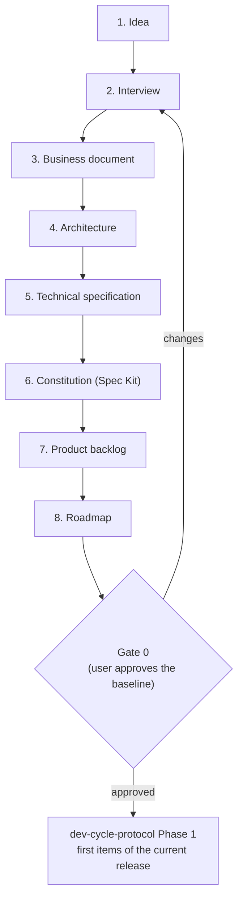

# 🌱 Product Inception Skill (`product-inception`)

> **Paths**: `<skills_root>` is the folder that contains this skill (the parent of this `SKILL.md`'s folder). Use the real absolute path when running the commands.

Phase 0 of [`dev-cycle-protocol`](../dev-cycle-protocol/SKILL.md), usually reached through [`/dev-cycle "<idea>"`](../dev-cycle/SKILL.md) in a new repository (or the adoption option of `/dev-cycle` in an existing one): it runs **once per product**, before the first change, and produces the **product baseline** every later phase builds on. It owns the process and the two product documents; the other artifacts are written with the role that owns them.

| Artifact | Owner | Where |
|---|---|---|
| Business document | `product-inception` | `docs/product/VISION.md` (`product.vision`) |
| Technical specification | `product-inception` | `docs/product/TECH_SPEC.md` (`product.tech_spec`) |
| Architecture style | [`software-design`](../software-design/SKILL.md) | `architecture.style` in `.dev-cycle.json` |
| Technical docs and founding ADRs | [`architecture-docs`](../architecture-docs/SKILL.md) | `TECDOC.md`, `docs/architecture`, `docs/adr` |
| Constitution (Spec Kit only) | `dev-cycle-protocol` | `.specify/memory/constitution.md`, generated |
| Backlog of the complete product | [`plan-memory`](../plan-memory/SKILL.md) | `docs/BACKLOG.md`, epics and items |
| Roadmap | [`plan-memory`](../plan-memory/SKILL.md) | `docs/ROADMAP.md` |

Talk to the user in their language; write every artifact in **English** (or the language set in `architecture_docs.language`).

---

## 🔄 The Process



**Each step ends with the user's approval** of what it produced, before the next one starts. The user may go back at any time: an answer that changes an approved document reopens it, and it is edited in place (it describes the product today, not its history). Stay **consultative** until gate 0: no product code is written in Phase 0.

### 1. 💡 Idea
The user's prompt. Repeat it back in two or three sentences (what, for whom, why) so both sides start from the same understanding. If the project folder is new, choose the branching model with the user (`devops-release`, "Branching Model": `integration`, `trunk` or `release-branches`, with a recommendation), initialize the repository (`git init` with `main`, plus `dev` for `integration`) and create `.dev-cycle.json` with `project_name` and `devops.branching`.

### 2. 🎤 Interview
Rounds of **at most five questions**, each with your **suggestion** (a proposed answer the user can accept, change or reject), ordered by impact on scope. Cover, over the rounds:
- **Problem and users**: who has the problem, how they cope today, the primary user group.
- **Value and business**: why they would switch, who pays and for what, how success is measured.
- **Scope**: the capabilities of the complete product, what is deliberately out (non-goals).
- **Constraints and risks**: platforms, budget, deadlines, regulations, existing systems, team skills.
- **Technical shape**: platforms, data, integrations, non-functional requirements that matter.

Rules:
- Never invent an answer the user did not give; a gap is an open question, recorded as such.
- Prefer concrete examples and numbers ("how many users in the first year?") over abstract choices.
- After each round, summarize what was decided and what is still open. Stop interviewing when the next round would not change the documents.

### 3. 📈 Business Document (`VISION.md`)
Create the documents from the templates, then write the vision:
```powershell
& "<skills_root>/dev-cycle-protocol/bin/dev-cycle.ps1" product-inception check_product --init
```
Sections: Problem, Target Users, Value Proposition, Business Model, Success Metrics, Scope, Non-Goals, Risks and Assumptions, Open Questions. Show it to the user; on approval, move on.

### 4. 🏛️ Architecture
- Choose the **architecture style** with `software-design` (its style guides compare the options); propose one with the reason and the alternatives, and record the choice in `.dev-cycle.json` (`architecture.style`, `core_path`, `surfaces` when known).
- Create the technical documentation with `architecture-docs`: the index, the first subsystem pages (the main parts, short), and an **ADR for each founding decision** with alternatives (style, main stack, data store, hosting).

### 5. 🔧 Technical Specification (`TECH_SPEC.md`)
Sections: Platforms and Stack, Architecture Overview (links to the technical docs), Non-Functional Requirements (measurable: performance, security and privacy, availability and recovery, accessibility and localization), Integrations, Data, Constraints, Open Questions. It holds the product-wide technical decisions; how each part works stays in the technical docs.

### 6. 📜 Constitution (only when Spec Kit is used)
Ask the user whether the project uses Spec Kit for the detail of features (see `dev-cycle-protocol`, "Spec Kit"). If yes, initialize it and generate the constitution from the baseline:
```powershell
python "<skills_root>/dev-cycle-protocol/speckit_setup.py" init
python "<skills_root>/dev-cycle-protocol/constitution.py" generate
```
The constitution is generated from `software-design`, the protocol's principles, the technical specification and the accepted ADRs; it is never edited by hand.

### 7. 📥 Product Backlog
The backlog of the **complete (ideal) product**, not only the first release:
- One **epic** per capability area of the Scope section (`backlog.py add --type epic --priority <p>`).
- Under each epic, its **features** (and improvements or adjustments when the project already exists), one line each, captured without discovery (`backlog.py add --type feature --epic EPIC-NNN ...`).
- Priorities come from the vision (value, risk, dependencies); show the list to the user, who decides.

### 8. 🗺️ Roadmap
Releases in delivery order, from the **MVP**: the smallest release that delivers the core value to the primary users and tests the riskiest assumptions. For each release: a version (`v0.1.0` for a first MVP, unless the project's versioning says otherwise), a name, a goal and its items:
```powershell
python "<skills_root>/plan-memory/roadmap.py" add-release v0.1.0 --name "MVP" --goal "<what users can do>"
python "<skills_root>/plan-memory/roadmap.py" assign EPIC-001 FEAT-007 --release v0.1.0   # an epic adds its open items
python "<skills_root>/plan-memory/roadmap.py" show
```
Fit each item where it belongs: dependencies first, the MVP lean, later releases grouped by goal. Items not yet scheduled stay in the backlog (`roadmap.py current` lists them).

### 🔒 Gate 0: Product Baseline (user)
```powershell
python "<skills_root>/dev-cycle-protocol/verify_gate.py" --gate 0
```
It checks both product documents (`check_product`), the architecture style, the technical docs, a valid backlog with epics, a valid roadmap with a first release, Spec Kit and the constitution when enabled, and secret hygiene. Open questions are listed: answer them, or the user explicitly accepts them as open.

End with (in the user's language): *"This is the product baseline. Would you like to adjust anything, or do you approve it so we start with the first items of the roadmap?"* After a short, explicit approval, commit the baseline (`docs(product): product baseline`) and continue with `dev-cycle-protocol` Phase 1 for the first items of the current release (`roadmap.py current`).

---

## 🧭 Adopting an Existing Project

The same steps, written **from the code base**: read the README, the technical docs, the code structure, the tests and the open issues; draft each document from what exists, then ask the user only what the code cannot answer (business model, users, success metrics, non-goals, priorities). Existing work in progress becomes backlog items; the roadmap starts at the next version after the current one. Do not rewrite existing technical docs: migrate them with `architecture-docs` if needed.

---

## ⚙️ Commands

`check_product` runs on the native engine: in sh shells (Linux, macOS, Git Bash) as below, in PowerShell `& "<skills_root>/dev-cycle-protocol/bin/dev-cycle.ps1" product-inception check_product [args]`.

| Task | Command |
|---|---|
| Create the missing product documents | `"<skills_root>/dev-cycle-protocol/bin/dev-cycle" product-inception check_product --init` |
| Check the product documents | `"<skills_root>/dev-cycle-protocol/bin/dev-cycle" product-inception check_product [--json]` |
| Gate 0 | `python "<skills_root>/dev-cycle-protocol/verify_gate.py" --gate 0` |

`check_product` reports missing or empty sections, template placeholders or instructions left in place, text not in the configured language and documents over the line limit; open questions are warnings. Configuration (`.dev-cycle.json`):
```json
"product": { "vision": "docs/product/VISION.md", "tech_spec": "docs/product/TECH_SPEC.md", "max_lines": 400 }
```

---

## 🔁 After Inception

The product documents are **living documents**: when a decision changes the vision or the technical specification (a new user group, a new platform, a changed requirement), edit them in place in the plan of that change, regenerate the constitution when Spec Kit is used, and keep the backlog and roadmap in step. A new release cycle starts from `roadmap.py current`.
